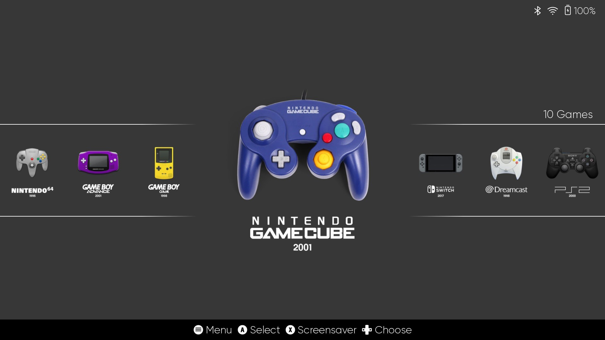
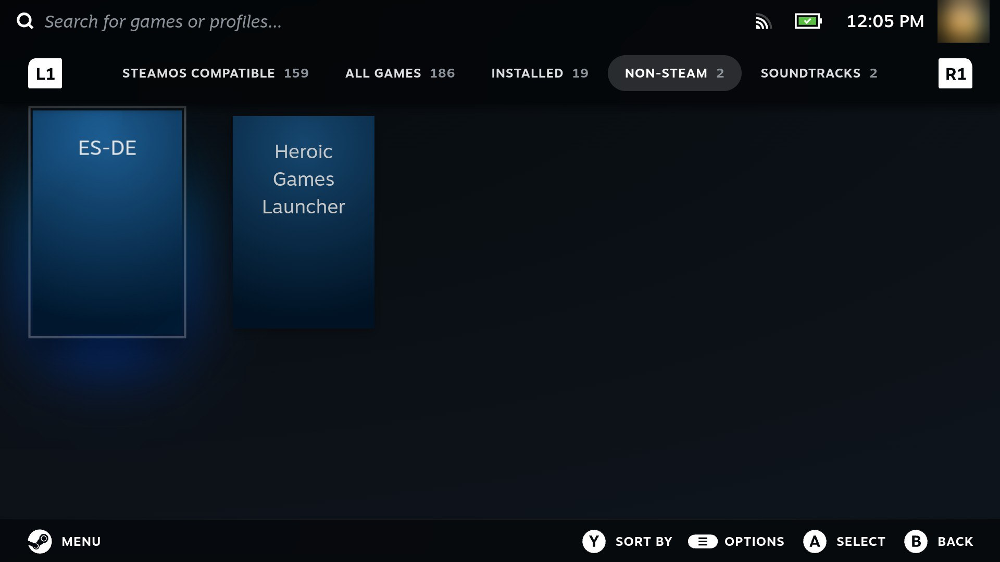

# Emulation

Steamling offers **ES-DE** as the frontend, with RetroArch and a few standalone emulators doing
the work. It is "drop your files in and play": no per-emulator setup, and games you favorite in
ES-DE show up in your Steam library automatically.



## Supported systems

| System | Emulator |
|---|---|
| NES / Famicom | RetroArch (FCEUmm) |
| SNES / Super Famicom | RetroArch (Snes9x) |
| Nintendo 64 | RetroArch (Mupen64Plus-Next) |
| Game Boy / Game Boy Color | RetroArch (Gambatte) |
| Game Boy Advance | RetroArch (mGBA) |
| Nintendo DS | RetroArch (melonDS) |
| Nintendo 3DS | Azahar |
| GameCube / Wii | Dolphin |
| Nintendo Switch | Eden or Ryujinx (bring your own build, see [below](#using-your-own-emulator-build)) |
| Sega Master System / Genesis / Game Gear / Sega CD | RetroArch (Genesis Plus GX) |
| Sega Saturn | RetroArch (YabaSanshiro) |
| Sega Dreamcast | RetroArch (Flycast) |
| PlayStation | RetroArch (SwanStation) |
| PlayStation 2 | ARMSX2 |
| PlayStation Portable | PPSSPP |
| Arcade / Neo Geo | RetroArch (FBNeo) |

## Installing it

Emulation is optional, so a fresh install does not have it. Switch to desktop mode, open
**Steamling Tools** and pick *Install the emulation layer (ES-DE + emulators)*. Everything is
ready when it finishes, with no restart or logout needed. ES-DE then has its own tile in your
Steam library, under the **Non-Steam** tab.



The emulators come from your own Steamling build, the same way updates do, so the handheld needs to
reach your PC while it installs: build with `./build.sh --update`, start the package server and
point the handheld at your PC, as in [Updating from your own build](updating.md#updating-from-your-own-build-without-reflashing)
(steps 1 to 3). If the PC's server isn't running, the install stops and tells you so.

The same entry removes the layer again. Your ROMs, BIOS files, saves and emulator settings stay
where they are, so installing it again later picks up exactly where you left off.

Two other ways in, if you'd rather not go through desktop mode:

- **Bake it into the image** when you build: `./build.sh --emulation`. The handheld then has it
  from the first boot.
- **Over SSH**: `sudo steamling-layer install emulation` (and `remove emulation` to take it out
  again). It's the same thing the Steamling Tools entry runs.

## Where your files go

Everything lives under `~/Emulation` (created for you on first login):

```
~/Emulation/
  ROMs/<system>/     your games, one folder per system (gba, snes, psx, ps2, ...)
  BIOS/              BIOS / firmware / key files (see below)
  Saves/             in-game saves
  States/            save states
  Library/           what ES-DE reads: links to your games here and on a microSD card
```

Drop each game into the folder for its system (`~/Emulation/ROMs/gba/`, `~/Emulation/ROMs/snes/`,
and so on), then rescan in ES-DE. A single copy of `~/Emulation` is self-contained: ROMs, BIOS,
and saves all travel together.

### More room: games on a microSD card

You can keep games on the handheld and on a microSD card at the same time, and ES-DE shows them
all together. Put a card in and Steamling makes an `Emulation/ROMs/` folder on it, with the same
folder per system as `~/Emulation/ROMs`. Copy games into either one (from your PC, over the
network share, or with the card in a card reader) and they're in ES-DE the next time it starts.

```
~/Emulation/ROMs/snes/            games on the handheld
<card>/Emulation/ROMs/snes/       games on the card
~/Emulation/Library/snes/         both together: this is what ES-DE reads
```

- Take the card out and its games just drop off the list; put it back and they return. Your
  saves are on the handheld either way.
- If the same game is in both places, ES-DE lists it once and plays the handheld's copy.
- `Library` only holds links, rebuilt whenever a card goes in or out and every time ES-DE
  starts. Don't copy games into it: use `ROMs` on either side.
- The card can be formatted by Steam (ext4) or exFAT; both work.

Installs from before this change move ES-DE over to `Library` by themselves at the next login.
If you had pointed ES-DE's ROM directory somewhere else yourself, it's left as you set it:
**ES-DE Menu → Other Settings → ROM directory** and choose `~/Emulation/Library` to switch.

## BIOS and firmware

Some systems need BIOS or firmware files that Steamling cannot ship. Put them in
`~/Emulation/BIOS/`, and **use the exact filenames** below:

| System | File(s) | Notes |
|---|---|---|
| **PlayStation 2** | `ps2-bios.bin` | Rename your BIOS dump to exactly this. Any region works. |
| PlayStation | `scph5501.bin` (US), `scph5500.bin` (JP), `scph5502.bin` (EU) | Standard names, as dumped. |
| Dreamcast | `dc/dc_boot.bin`, `dc/dc_flash.bin` | Note the `dc/` subfolder. |
| Sega CD | `bios_CD_U.bin`, `bios_CD_E.bin`, `bios_CD_J.bin` | One per region. |
| Game Boy Advance | `gba_bios.bin` | Optional; improves accuracy. |
| **Nintendo Switch** | `prod.keys`, `title.keys` + firmware | Not in `BIOS/`. Eden: keys in `~/.local/share/eden/keys/`, firmware `.nca` files in `~/.local/share/eden/nand/system/Contents/registered/`. Ryujinx: keys in `~/.config/Ryujinx/system/`, firmware installed from its own menu. |

If a game will not boot, the emulator's error message usually names the exact file it is missing.
A missing or misnamed BIOS is the most common cause.

## Copying files over the network

Rather than shuttling a microSD card back and forth, you can turn the device into a network
share and drag files straight onto it from another computer. It works out of the box in macOS
Finder, Windows Explorer and Linux file managers - no extra software on either end.

> **Got a USB-C cable handy?** That's often quicker: turn on **USB file transfer** in
> Governor's Files tab and the device shows up on your computer like a phone does. See
> [USB file transfer](governor.md#usb-file-transfer).

Turn it on in either place:

- **Game Mode**: Quick Access Menu → **Governor** → **Files** → *Share my home folder*
- **Desktop**: **Steamling Tools** → *File sharing (SMB) is off - turn it on...*

The first time, you will be offered a small download (Samba is not shipped in the image, so
devices that never share a file never pay for it). It then stays on across reboots until you
turn it off in the same place.

Once it is on, open one of these from the other computer:

| | |
|---|---|
| macOS | Finder → the device appears in the sidebar under **Network**, or press ⌘K and enter `smb://steamling.local` |
| Windows | Explorer address bar: `\\steamling.local` |
| Linux | Files → *Other Locations* → `smb://steamling.local` |

**Connect as Guest - there is no password.** Two shares appear:

- **deck** - your home folder, so `Emulation/` for ROMs and BIOS, and the per-emulator folders
  described above for firmware and keys
- **sdcard** - whatever is in the SD card slot

> [!WARNING]
> There is no password, so **anyone on the same network** can read and write everything in your
> home folder - not just games and saves, but your Steam login and SSH keys too. Sharing is
> limited to private home-network address ranges, so joining public wifi does not expose the
> device, but treat it as "on while I am at home" rather than something to leave running.

## Getting games into Steam

Favorite a game in ES-DE (the Favorite button), quit ES-DE, and re-enter Game Mode. The game
appears in your Steam library in a "Steamling" collection, ready to launch straight from Big
Picture. Un-favorite to remove it. Favorites are synced when you enter Game Mode, so they show up
on the next entry, never mid-session.

## Tweaking individual emulator settings

The defaults were set up on the Retroid Pocket 6, and you can change any emulator's settings whenever you like:

- **RetroArch systems** (NES, SNES, N64, Game Boy, GBA, DS, Genesis, Saturn, Dreamcast,
  PlayStation, Arcade, and more): while a game is running, open the **RetroArch Quick Menu**
  (click both sticks in, L3 + R3, on the controller, or press F1 on a keyboard). From there you can
  change the core options, video/shader settings, controls, and save an override that applies to
  that game or that whole system.
- **Standalone emulators** (ARMSX2 for PS2, RPCS3 for PS3, Vita3K for PS Vita, Dolphin for
  GameCube/Wii, Cemu for Wii U, PPSSPP for PSP, Azahar for 3DS, xemu for the original Xbox,
  Eden or Ryujinx for Switch): each has its own in-app settings menu. Launch the emulator
  from the desktop to reach its full configuration UI.

Settings you change are yours: when a Steamling update ships a better default, only settings you
never touched follow it. **Steamling Tools** has a *Restore emulator default settings* entry that
puts one emulator, or all of them, back to the shipped defaults, keeping your old file as a
`.bak-<date>` copy.

## Using your own emulator build

Every standalone emulator has a folder under `~/Emulation/emulators/`: `eden`, `ryujinx`,
`armsx2`, `rpcs3`, `vita3k`, `xemu`, `dolphin`, `cemu`, `azahar`, `ppsspp`. Put **one** file in
it, an AppImage or a binary, and Steamling launches that instead of its own build, from ES-DE and
from Steam favorites alike, with the same pre-made settings. Remove the file to go back to the
built-in one. A folder with more than one file is ignored.

**Nintendo Switch is bring-your-own only.** Steamling ships no Switch emulator. Drop an Eden or a
Ryujinx build into its folder and it is set up on first launch: controller, fullscreen, vsync and
resolution. With both present, choose which one runs in ES-DE under *Other Settings, Alternative
Emulators*; Steam favorites follow that choice. If you had Eden installed by an earlier Steamling
version, it is moved into `~/Emulation/emulators/eden/` for you and keeps working.

## What is already set up for you

- **RetroArch**: controller mapping, 120Hz-panel frame pacing, and sensible per-system tuning
  (for example integer scaling and an LCD shader on GBA).
- **PlayStation 2 (ARMSX2)**: setup wizard skipped, Vulkan renderer, controller bound, and
  upscaling enabled. You only supply `ps2-bios.bin` and your games.
- **Nintendo Switch (Eden or Ryujinx, your own build)**: controller bound, fullscreen, vsync and
  resolution tuned for the panel. You supply the emulator, your keys and firmware (see above)
  and your games.
- **ES-DE**: scans `~/Emulation/ROMs` and already knows where every emulator is installed.
