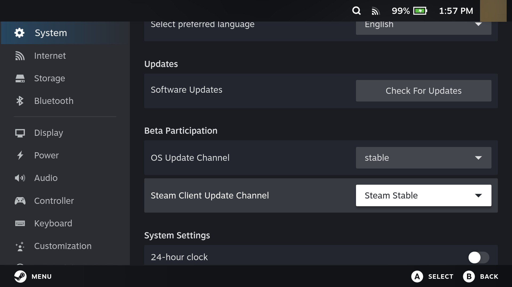

# Updating Steamling

Steamling updates over the internet from its own package repo, the same way it gets everything
else. There are three ways to run an update, and they all do the same thing:

- **Governor → System → Check for Updates** in game mode, then **Install Updates**
  ([more about the System tab](governor.md#system))
- the **Steamling Updater** app in desktop mode
- `sudo pacman -Syu` in a terminal

Restart when it finishes so everything takes effect. Keep the handheld charged or plugged in while
an update installs.

Some things update on their own: the Steam client updates itself and tells you when one is ready,
Decky offers its own updates, and games update through Steam as usual.

## What an update covers

- **Steamling's own packages**: the kernel, Mesa, gamescope, Governor, the emulators and the rest.
  These come from Steamling's package repo whenever a new version is published.
- **The Arch Linux ARM side**: everything else on the system. Steamling pins it to a tested
  snapshot of Arch Linux ARM, its frozen base, so it only changes when a new Steamling release
  moves that snapshot forward, not every day.

You don't need to reflash for a new release: an installed handheld gets everything through
updates. A new image is only for setting up a handheld from scratch.

Updates also tidy up after themselves. When Steamling stops needing a package (a tool dropped
from the image, a library only an old version used), the first boot after the update removes it,
as long as nothing on the handheld still depends on it. The list, with the reason for each, is
`/usr/share/steamling/retired-packages`, and `journalctl -u steamling-retire` shows what was
removed. As with any update, a [snapshot](snapshots.md) is taken first, so a removal can be undone.

## If an update goes wrong

Every update takes a snapshot of the system first. If something breaks, **Roll Back Last Update**
in Governor's System tab puts the system back the way it was, and
[Snapshots and rollback](snapshots.md) has the other ways to do it, and what to do if it won't boot.

## Handhelds set up before the package repo

If you set up your handheld from your own build before the package repo existed (November 2026),
it doesn't update from the repo yet. Either flash a current image (which wipes the card, so back up
your saves first), or switch it over without reflashing as
[Switching an older handheld to the package repo](building/updating-from-your-pc.md#switching-an-older-handheld-to-the-package-repo)
shows.

If you build Steamling yourself and want to try your own build on a handheld before it's
published, see [Updating a handheld from your own build](building/updating-from-your-pc.md).

## Steam's update channel

Steam's **Settings → System → Beta Participation** has two drop-downs:

- **Steam Client Update Channel** switches the Steam client between **Steam Stable** and
  **Steam Beta**. Steam restarts onto the channel you pick, and it stays on it across reboots.
- **OS Update Channel** always reads **stable** and has nothing else to pick. Steam's own system
  update check isn't connected to Steamling: system updates come through Governor → System, as
  above.

